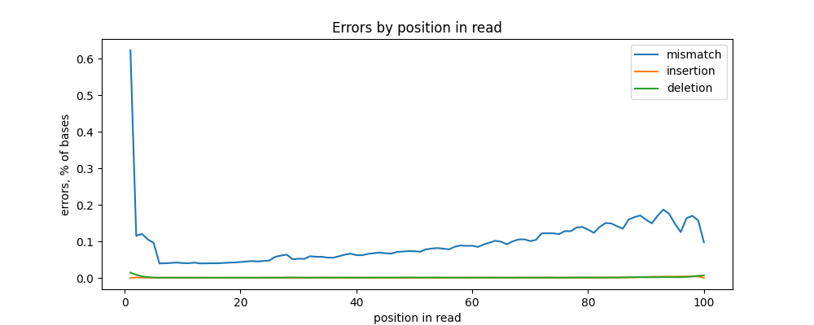
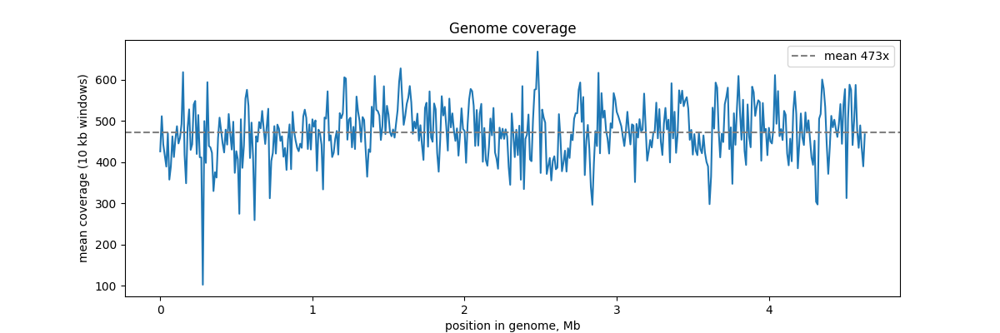

# Algorithms Engineering

We got  DNA pieces from a bacteria. For each genome peace we need to find the spot in the genome where it came from and try to find as many information as possible.

## Data:
- Download the reference genome of E. coli bacteria: https://ftp.ncbi.nlm.nih.gov/genomes/all/GCF/000/005/845/GCF_000005845.2_ASM584v2/GCF_000005845.2_ASM584v2_genomic.fna.gz
- Download genome reads in FASTQ format: ftp://ftp.sra.ebi.ac.uk/vol1/fastq/ERR022/ERR022075/ERR022075_1.fastq.gz

They are really heavy, so i did not put them in the rep.

### To make the measurments run:
```
gcc -Wall mapper.c -o mapper
./mapper hash GCF_000005845.2_ASM584v2_genomic.fna ERR022075_1.fastq
./mapper bwt GCF_000005845.2_ASM584v2_genomic.fna ERR022075_1.fastq
python3 plot.py
```

`hash` and `bwt` are two approaches from the lecture, the answer is the same =)

The program prints the numbers and makes `coverage.csv` and `errors.csv`

## How it works:

| Step | What happens | Function |
|---|---|---|
| Index | Make a fast search over the genome: hash table (`hash`) or BWT (`bwt`) | `build_hash`, `build_bwt` |
| Trim | Cut the junk tail of the genome piece | `map_read` |
| Seed | Cut the genome piece into 16-letter chunks and find them in the genome | `find_hash`, `find_bwt` |
| Extend | Near each found spot count how many fixes (swap, add or drop a letter) the genome piece needs to become the same as the genome | `align` |
| Flip | Do the same for the flipped genome piece (the other DNA strand) | `map_read` |
| Pick | One best spot = unique, a few = multi, none = unmapped | `map_read` |

### Algorithms used:
 hash table of 16-letter chunks (A=0, C=1, G=2, T=3, the chunk is read as a number in base 4, hash = this number % 4000037 (prime close to len of DNA)), BWT with suffix array, seed and extend, edit distance (dynamic programming)

### Settings:
- a chunk is 16 letters long
- a genome piece can have at most 8% errors (8 errors for 100 letters (больше - почти безсмвсленно))
- after cutting the tail a genome piece must be at least 30 letters long

## Results

We had 22720100 peaces of len 100

### Genome pieces:

| What | Genome pieces | % of all |
|---|---|---|
| Total | 22720100 | 100% |
| Mapped | 22617983 | 99.55% |
| unique (one best spot in the genome) | 22191257 | 97.67% |
| multi (a few equally good spots) | 426726 | 1.88% |
| Unmapped (ужас) | 102117 | 0.45% |

17.54% of genome pieces (3984635) had the end of piece where the quality line. `#`or `!` - to be cuted off

### Why some genome pieces did not map:

| Reason | Genome pieces | % of all (round 0.01)|
|---|---|---|
| Too short after cutting the tail | 79427 | 0.35% |
| Chunks found, but too many errors | 17869 | 0.08% |
| No chunk found at all | 4738 | 0.02% |
| Too many `N` letters | 83 | 0.00% |

Most of them are just trash

### Alignment quality:

How we count errors: we put the genome piece next to its spot in the genome and find the smallest number of fixes that makes them the same `align` possible action is one of three things: swap a letter, drop an extra letter add a letter. Each action is `one error`

| #errors | Genome pieces | % |
|---|---|---|
| 0 | 20807716 | 92.00% |
| 1 | 1593522 | 7.05% |
| 2 | 166638 | 0.74% |
| 3 | 32748 | 0.14% |
| 4 | 9732 | 0.04% |
| 5 | 3657 | 0.02% |
| 6 | 1850 | 0.01% |
| 7 | 1314 | 0.01% |
| 8 | 806 | <0.01% |

### Total result:
| What | Value |
|---|---|
| Letters same as the genome | 99.904% |
| Swapped letter (mismatch) | 98.1% of errors |
| Lost letter (deletion) | 1.4% of errors |
| Extra letter (insertion) | 0.6% of errors |
| Forward strand | 50.03% of mapped |
| Reverse strand | 49.97% of mapped |



This graph is showing where in the genome piece the machine makes errors. The longer the machine reads - the more errors it makes: about 0.04% near the start, up to 0.19% near the end. The peak at letter 1 (0.62%) is mostly because of `N`: about 123k genome pieces start with `N`, about 110k of them are long enough to be mapped, this explains up to 78% of the errors at letter 1. Letters 2-5 are also a bit worse than the next ones (0.10-0.12%)

### Coverage:

| What | Value |
|---|---|
| Genome size | 4641652 chars |
| Mean coverage | 473x |

How many genome pieces cover each letter of the genome:

| Covered by | Letters | % of genome |
|---|---|---|
| 0 genome pieces | 754 | 0.016% |
| 1 | 403 | 0.009% |
| 2 | 583 | 0.013% |
| 3 | 293 | 0.006% |
| 4 | 299 | 0.006% |
| 5 | 268 | 0.006% |
| 6 | 338 | 0.007% |
| 7 | 167 | 0.004% |
| 8 | 234 | 0.005% |
| 9 | 295 | 0.006% |
| 10 and more | 4638018 | 99.922% |



Spots with zero genome pieces (0 coverage):

| From | To | Length |
|---|---|---|
| 283714 | 284217 | 504 |
| 284526 | 284592 | 67 |
| 284902 | 284991 | 90 |
| 287623 | 287668 | 46 |
| 523642 | 523687 | 46 |
| 3424237 | 3424237 | 1 |

The last spot is one letter in a repeated part of the genome. Genome pieces from repeated parts fit a few spots equally well, the mapper puts each of them into one of these spots by random


### Hash vs BWT:

| | Hash | BWT |
|---|---|---|
| Build the index | 1.5 s | 1.7 s |
| Map all genome pieces | 457 s | 1181 s |
| Speed | 50k genome pieces per sec | 19k genome pieces per sec |
| Index memory | 33.0 MB | 23.2 MB |

# Total sumup:

- We mapped 22617983 genome pieces out of 22720100
- On average one letter of the genome is covered by 473 genome pieces
- Hash is much faster than BWT (457s vs 1181s), but BWT needs a bit less memory (23.2MB vs 33.0MB)
- 92% of mapped genome pieces have no errors. In the other 8% the errors are: 98.1% swapped letter, 1.4% lost letter, 0.6% extra letter
- Genome pieces with errors mostly have just one: 7.05% have 1 error, 0.74% have 2 errors, 0.22% have 3 or more (max is 8)
